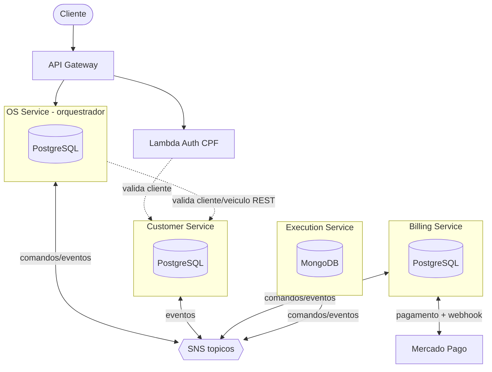
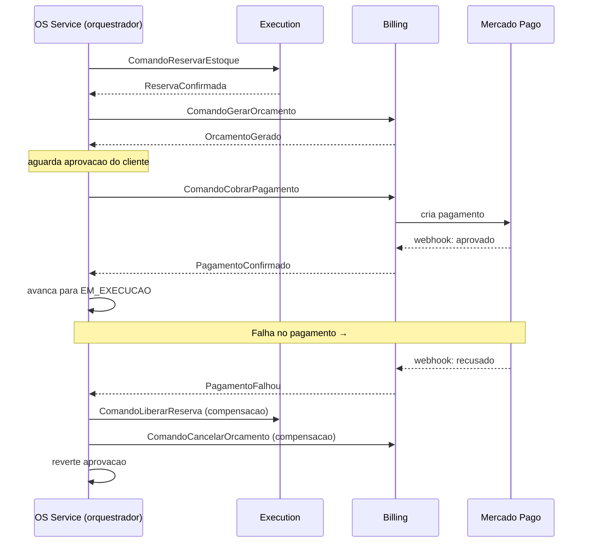

# Arquitetura Alvo — Microsserviços (Fase 4)

Refatoração do monólito **workbench-monolith** para 4 microsserviços independentes com
banco próprio, mensageria assíncrona (SNS/SQS) e Saga orquestrada.

> Decisão formalizada em `workbench-monolith/docs/adr/ADR-0003-arquitetura-microsservicos-fase4.md`.

## Serviços

| Serviço | Bounded context | Migra do monólito | Banco |
|---|---|---|---|
| **Customer Service** | Clientes + veículos + validações + auth CPF | `client`, `vehicle` | PostgreSQL |
| **OS Service** | Ciclo de vida da OS + **orquestração da Saga** | `serviceorder`, `service` | PostgreSQL |
| **Billing Service** | Orçamento + pagamento (Mercado Pago) | `budget` + novo `payment` | PostgreSQL |
| **Execution Service** | Fila de execução + estoque + produtos | `stock`, `product` | MongoDB |

## Diagrama de componentes

## Fluxo da Saga (orquestrada pelo OS Service)

## Links Relacionados
- [[Visao Geral]]
- [[Contratos de Mensagem]]
- [[Convencoes Microsservicos]]
