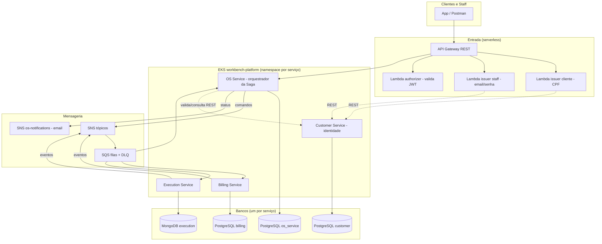

# Workbench — Arquitetura da Plataforma (Fase 4) — V2

> **Documento de referência da entrega** (Tech Challenge — FIAP Pós Tech, Fase 4).
> Evolução da V1: além do diagrama geral e do Saga Pattern, cobre o **design**, a
> **justificativa de cada banco**, o **mapa de todos os repositórios** (com links e o
> porquê de cada um existir) e as **funcionalidades** de cada serviço e do sistema.

Organização GitHub: **[TechChalleng-FIAP-SOAT](https://github.com/TechChalleng-FIAP-SOAT)**

---

## Sumário

1. [Visão do produto](#1-visão-do-produto)
2. [Do monólito aos microsserviços](#2-do-monólito-aos-microsserviços)
3. [Design e princípios de arquitetura](#3-design-e-princípios-de-arquitetura)
4. [Diagrama geral](#4-diagrama-geral)
5. [Mapa de repositórios (o quê, por quê, link)](#5-mapa-de-repositórios)
6. [Os microsserviços em detalhe](#6-os-microsserviços-em-detalhe)
7. [Por que cada banco (SQL vs NoSQL)](#7-por-que-cada-banco)
8. [Comunicação entre serviços](#8-comunicação-entre-serviços)
9. [Saga Pattern — o quê, por quê, como](#9-saga-pattern)
10. [Autenticação e autorização](#10-autenticação-e-autorização)
11. [Funcionalidades do sistema (visão de ponta a ponta)](#11-funcionalidades-do-sistema)
12. [Observabilidade](#12-observabilidade)
13. [Qualidade, testes e CI/CD](#13-qualidade-testes-e-cicd)
14. [Resumo de tecnologias](#14-resumo-de-tecnologias)

---

## 1. Visão do produto

A **Workbench** é a plataforma de uma oficina mecânica que atingiu escala nacional e
opera com múltiplas filiais. O negócio gira em torno da **Ordem de Serviço (OS)**: o
cliente leva o veículo, a oficina diagnostica, orça, executa e entrega — cobrando ao
final. Em escala, isso envolve quatro áreas (atendimento, diagnóstico, execução e
cobrança) que precisam operar de forma independente, resiliente e tolerante a falhas.

---

## 2. Do monólito aos microsserviços

Na Fase 3, a oficina era um **monólito** (`workbench-monolith`): uma aplicação Spring
Boot, um banco, um deploy. Funcionava com operação pequena, mas trouxe limites:

- **Acoplamento**: qualquer mudança exigia reempacotar e reimplantar tudo.
- **Escala única**: não dava para escalar só o que sofria carga (ex.: estoque/execução).
- **Resiliência**: uma falha podia derrubar o sistema inteiro.
- **Evolução lenta**: times diferentes competindo pelo mesmo código.

A **Fase 4** refatora o monólito em **microsserviços independentes** — cada um com
repositório, infraestrutura e banco próprios — e introduz o **Saga Pattern** para
manter a consistência das transações que agora atravessam vários serviços. O monólito
é preservado como **base histórica** e referência das decisões (ADRs/RFCs).

> **Paridade preservada:** nenhuma funcionalidade do monólito foi perdida na
> migração — login de staff, notificação de status ao cliente por e-mail, relatório
> de tempo médio de execução e a autorização por dono da OS foram todos
> reintroduzidos nos microsserviços.

---

## 3. Design e princípios de arquitetura

A plataforma segue um conjunto de princípios consistentes em todos os serviços:

- **Arquitetura Hexagonal (Ports & Adapters):** cada serviço separa `domain`
  (regras de negócio puras), `application` (casos de uso + portas) e
  `infrastructure`/`adapter` (web, persistência, mensageria). Isso mantém o núcleo
  testável e independente de framework.
- **Database per service:** cada serviço é dono do seu banco. **Nenhum serviço
  acessa o banco de outro** — o que precisa de dado alheio pede por REST ou reage a
  um evento. Isso elimina acoplamento no nível de dados.
- **Comunicação híbrida:** REST síncrono quando a resposta é imediata (validações,
  consultas); mensageria assíncrona (SNS/SQS) para o fluxo da Saga, desacoplando os
  serviços no tempo.
- **Saga orquestrada:** o OS Service é o orquestrador central que coordena o fluxo e
  as compensações (ver seção 9).
- **Cluster compartilhado, namespace por serviço:** um único EKS
  (`workbench-platform-<env>`) com um namespace por serviço — isola sem multiplicar
  o custo de um cluster por microsserviço.
- **IaC + CI/CD:** toda a infra é Terraform; cada serviço tem pipeline própria
  (build, testes, cobertura, qualidade, imagem, deploy).

---

## 4. Diagrama geral



---

## 5. Mapa de repositórios

Onze repositórios na org **TechChalleng-FIAP-SOAT**. Cada um existe por um motivo
específico; os 4 primeiros são os microsserviços (requisito do PDF), os demais são
infra e documentação.

| Repositório | O que é | Por que existe |
|---|---|---|
| [workbench-os-service](https://github.com/TechChalleng-FIAP-SOAT/workbench-os-service) | Microsserviço de Ordem de Serviço + **orquestrador da Saga** | Coração do fluxo; coordena os demais serviços e mantém o estado da Saga |
| [workbench-billing-service](https://github.com/TechChalleng-FIAP-SOAT/workbench-billing-service) | Microsserviço de Orçamento e Pagamento | Isola a área de cobrança (orçamento + integração Mercado Pago) |
| [workbench-execution-service](https://github.com/TechChalleng-FIAP-SOAT/workbench-execution-service) | Microsserviço de Execução e Produção (estoque/produtos/reservas) | Isola o catálogo e o estoque — a parte que mais sofre carga e exige NoSQL |
| [workbench-customer-service](https://github.com/TechChalleng-FIAP-SOAT/workbench-customer-service) | Microsserviço de Clientes, Veículos e **Identidade (staff)** | Dono dos cadastros de pessoas; serviço de identidade da plataforma |
| [workbench-lambda](https://github.com/TechChalleng-FIAP-SOAT/workbench-lambda) | Funções serverless de autenticação (issuer cliente, issuer staff, authorizer) | Requisito de "Function Serverless"; emite/valida o JWT fora dos serviços |
| [workbench-gateway](https://github.com/TechChalleng-FIAP-SOAT/workbench-gateway) | AWS API Gateway (REST) — porta de entrada única | Roteamento + proteção de rotas via authorizer; separado do ciclo de vida das Lambdas |
| [workbench-messaging](https://github.com/TechChalleng-FIAP-SOAT/workbench-messaging) | IaC da mensageria (SNS/SQS/DLQ + tópico de notificação) | Centraliza os contratos de tópicos/filas da Saga e as notificações |
| [workbench-database](https://github.com/TechChalleng-FIAP-SOAT/workbench-database) | IaC do banco relacional (RDS PostgreSQL) | Provisiona o banco gerenciado parametrizado por serviço/ambiente |
| [workbench-k8s-terraform](https://github.com/TechChalleng-FIAP-SOAT/workbench-k8s-terraform) | IaC da rede + cluster (VPC + EKS + metrics-server) | Base de infra compartilhada que os demais stacks consomem |
| [workbench-monolith](https://github.com/TechChalleng-FIAP-SOAT/workbench-monolith) | Monólito da Fase 3 (base histórica) + ADRs/RFCs | Referência das decisões e origem da refatoração |
| [workbench-technical-documentation](https://github.com/TechChalleng-FIAP-SOAT/workbench-technical-documentation) | Documentação técnica + collection Postman da plataforma | Documentação central (este documento) e artefatos de API |

---

## 6. Os microsserviços em detalhe

### OS Service — `workbench-os-service`
- **Responsabilidade:** abertura da OS, diagnóstico, máquina de estados, decisão do
  orçamento e **orquestração da Saga**.
- **Funcionalidades:** criar/listar/buscar OS; registrar diagnóstico (inicia a Saga);
  aprovar/recusar orçamento (**com validação de ownership** — cliente só decide a
  própria OS); catálogo de tipos de serviço; **notificação de status ao cliente por
  e-mail**; **relatório de tempo médio de execução** (`/monitoring`).
- **Banco:** PostgreSQL (`os_service`).

### Billing Service — `workbench-billing-service`
- **Responsabilidade:** geração do orçamento, cobrança e verificação de pagamento.
- **Funcionalidades:** gerar orçamento (via comando da Saga); criar cobrança
  (integração **Mercado Pago**, com adapter fake para dev); webhook de aprovação/
  recusa; histórico de pagamento.
- **Banco:** PostgreSQL (`billing`).

### Execution Service — `workbench-execution-service`
- **Responsabilidade:** catálogo de peças/insumos e **estoque com reservas**.
- **Funcionalidades:** CRUD de produtos; controle de estoque (entrada/saída/mínimo);
  verificação de disponibilidade; **reservar / confirmar (baixa) / liberar**
  reservas — os três comandos que a Saga usa para garantir o estoque.
- **Banco:** MongoDB (`execution`).

### Customer Service — `workbench-customer-service`
- **Responsabilidade:** clientes, veículos e **identidade do staff**.
- **Funcionalidades:** CRUD de clientes (CPF/CNPJ) e veículos (placa, vínculo ao
  dono); **cadastro de usuário staff** (BCrypt) e **validação de credenciais** (usada
  pela Lambda de login de staff).
- **Banco:** PostgreSQL (`customer`).

---

## 7. Por que cada banco

O PDF exige **pelo menos um banco SQL e um NoSQL** no conjunto. A escolha por serviço
seguiu a natureza do dado, não a obrigatoriedade:

| Serviço | Banco | Por quê |
|---|---|---|
| OS Service | **PostgreSQL** | A OS é fortemente **relacional e transacional**: OS ↔ serviços ↔ estado da Saga, com integridade referencial (FKs) e transições de status que exigem ACID. |
| Billing | **PostgreSQL** | Orçamento e pagamento são **financeiros**: consistência forte, histórico auditável e relações orçamento↔itens↔pagamento. |
| Customer | **PostgreSQL** | Cliente↔veículo é um vínculo **relacional** com unicidade (documento/placa) e FK dono→veículo; usuários staff também são tabulares. |
| Execution | **MongoDB** | Estoque/produtos têm **esquema flexível** (atributos variáveis por tipo de peça) e alto volume de leitura/escrita de reservas; o modelo de **documento** encaixa melhor e escala horizontalmente. Além disso, usa transação multi-documento (replica set) onde precisa de atomicidade. |

Resultado: **3 PostgreSQL + 1 MongoDB** — cumpre SQL + NoSQL com justificativa técnica,
e cada serviço é **dono exclusivo** do seu banco (nenhum acesso cruzado — ADR-0003).

---

## 8. Comunicação entre serviços

- **REST (síncrono):** usado quando a resposta é necessária na hora.
  - OS Service → Customer Service: validar cliente/veículo ao criar a OS e resolver
    o e-mail do cliente para a notificação.
  - Lambdas de auth → Customer Service: resolver cliente por CPF / validar staff.
- **Mensageria (assíncrono, SNS/SQS):** usada no fluxo da Saga. O OS Service publica
  **comandos**; Billing e Execution consomem, processam e publicam **eventos** de
  resposta; o OS Service consome os eventos e avança a Saga. Cada fila tem **DLQ**
  (redrive após N tentativas) para tolerância a falhas.
- **SNS de notificação (`os-notifications`):** tópico dedicado onde o OS Service
  publica a mensagem de status formatada; uma subscription de e-mail entrega ao
  cliente (paridade com o monólito).

> **Regra de ouro:** nenhum serviço lê o banco de outro. Dado alheio = REST ou evento.

---

## 9. Saga Pattern

### O que é
Uma **Saga** é uma sequência de transações locais distribuídas por vários serviços,
onde cada passo publica um resultado e, **se algo falha, executa compensações** para
desfazer os passos já concluídos — garantindo consistência sem um commit distribuído
(2PC), que seria caro e frágil.

### Por que usamos
A abertura de uma OS atravessa OS → Execution (estoque) → Billing (orçamento/
pagamento). Não há uma transação ACID única entre bancos diferentes; a Saga mantém o
sistema **consistente ao final**, com rollback seguro em caso de falha — exatamente o
que o PDF exige.

### Como funciona (orquestrada)
Escolhemos a variante **orquestrada**: o **OS Service** é o maestro. Ele mantém um
`SagaState` persistido e decide o próximo comando (ou a compensação) a cada evento.

**Fluxo feliz:**
```
Criar OS → Diagnóstico → [Saga] Reservar estoque → Gerar orçamento
   → (aprovação humana) → Confirmar reserva (baixa) → Cobrar pagamento
   → (webhook) → OS PAGA → ENTREGUE
```

**Compensações (exemplos):**
- Recusa do orçamento → **libera a reserva** de estoque (volta ao disponível).
- Orçamento falha após N tentativas → compensa liberando a reserva.
- **Falha de pagamento NÃO estorna estoque** (o serviço já foi executado): a OS fica
  retida em `PAGAMENTO_PENDENTE`. Princípio consciente: *nem toda falha compensa* —
  só o que é logicamente reversível.

### Por que orquestrada (e não coreografada)
Com um orquestrador central, o fluxo e as compensações ficam **explícitos e
auditáveis** em um só lugar (o `SagaState`), em vez de espalhados por eventos
encadeados entre serviços. Isso simplifica o rastreamento e o tratamento de timeout/
retry, ao custo de centralizar a coordenação no OS Service — trade-off aceitável para
o tamanho do domínio. (Ver ADR-0005.)

---

## 10. Autenticação e autorização

- **Emissão de token (serverless):** a Lambda emite JWT (HS256, segredo compartilhado)
  em dois fluxos — **cliente** por CPF (`POST /auth`) e **staff** por e-mail/senha
  (`POST /auth/login`, validando no Customer Service). Token de cliente carrega
  `clientId` + `roles:[CLIENT]`; token de staff carrega as roles reais (ADMIN/
  TECHNICIAN), sem `clientId`.
- **Validação na borda:** o API Gateway usa um **Lambda authorizer** para proteger as
  rotas do os-service, exceto `/auth` e `/auth/login` (públicas por definição).
- **Validação por serviço (defesa em profundidade):** além da borda, **cada
  microsserviço valida o JWT por conta própria** (Spring Security + filtro HS256 com o
  mesmo segredo). Assim as chamadas internas (serviço→serviço) também exigem token, não
  só as que entram pelo gateway. Rotas públicas por serviço: health/Swagger; billing
  `POST /api/payments/webhook` (gateway de pagamento externo); customer
  `POST /api/users/auth/validate` (usado pela Lambda) — `signup` exige ADMIN.
- **Token de serviço:** nas chamadas internas (ex.: os-service → customer-service), o
  chamador emite um **JWT de serviço** (staff, curta duração) com o segredo
  compartilhado — inclusive nas threads assíncronas da Saga.
- **Autorização por role:** os serviços leem as roles das claims. No OS Service, a
  decisão de orçamento valida **ownership** — um cliente só decide a própria OS;
  staff decide qualquer uma.

### Boas práticas OWASP

| OWASP Top 10 | Como é tratado |
|---|---|
| A01 Broken Access Control | Autorização por role em todas as rotas; ownership na decisão do orçamento; JWT validado por serviço. |
| A02 Cryptographic Failures | Senha de staff com **BCrypt**; JWT assinado (HS256); segredos fora do código (secret manager). |
| A03 Injection | **Bean Validation** (`@Valid`) nos DTOs; acesso a dados via Spring Data (JPA/Mongo) parametrizado — sem concatenação de query. |
| A05 Security Misconfiguration | Headers `X-Frame-Options: DENY` + `nosniff`; `k8s/secret.yaml` com placeholders (`REPLACE_ME`), segredos reais injetados no deploy. |
| A07 Identification & Auth Failures | Fluxos de login dedicados; throttling no gateway contra brute-force/enumeração de CPF. |
| A09 Logging Failures | Logs estruturados (JSON) correlacionados por `saga_id`; **CPF mascarado** no log. |

> O hotspot `java:S4502` (CSRF desabilitado) é marcado **Safe** no SonarCloud: as APIs
> são REST **stateless** com JWT (sem cookie de sessão), onde CSRF não se aplica.

---

## 11. Funcionalidades do sistema

Visão de ponta a ponta, do ponto de vista de quem usa:

**Atendimento / Staff**
- Login de staff (e-mail/senha) → token ADMIN/TECHNICIAN.
- Abrir OS para um cliente/veículo; registrar diagnóstico (peças + mão de obra).
- Acompanhar o fluxo da OS pela máquina de estados.
- Consultar o **relatório de tempo médio de execução** por tipo de serviço.
- Cadastrar novos usuários staff.

**Cliente**
- Login por CPF → token CLIENT.
- Consultar o histórico das próprias OS.
- **Aprovar ou recusar** o orçamento da própria OS (ownership garantido).
- Receber **e-mail** a cada mudança de status da OS.
- Receber por **e-mail o link de pagamento** (checkout) quando a cobrança é criada;
  consultar o link a qualquer momento em `GET /api/payments/service-order/{osId}`.

**Sistema (automático)**
- Orquestração da Saga: reserva de estoque, geração de orçamento, confirmação/
  liberação de reserva, cobrança e entrega — com compensações.
- **Cobrança automática:** ao entrar em `PAGAMENTO_PENDENTE`, a Saga cria a cobrança
  no Billing sem ação manual.
- Integração de pagamento (Mercado Pago) com webhook **idempotente** que confirma o
  pagamento e avança a OS (`PAGAMENTO_APROVADO` → PAGO → ENTREGUE).
- Notificação de status e link de pagamento por SNS/e-mail.
- Observabilidade (métricas, logs correlacionados por `saga_id`).

---

## 12. Observabilidade

- **Métricas** (Micrometer → Datadog): métricas de negócio (`workshop.*`) e técnicas
  (JVM, HTTP); dashboards e monitores versionados por serviço + um dashboard agregado
  da plataforma.
- **Logs estruturados (JSON)** com `saga_id`/`service_order_id` no MDC: permite
  rastrear uma OS do início ao fim, cruzando os quatro serviços (filtro
  `@saga_id:<id>` no Datadog).
- **Health checks** (`/actuator/health`) usados pelas probes do Kubernetes.

---

## 13. Qualidade, testes e CI/CD

- **Testes unitários** em todos os serviços + **BDD** (fluxo completo no OS Service).
- **Cobertura ≥ 80%** por serviço (gate JaCoCo no `verify`).
- **SonarCloud** no CI (Quality Gate por PR).
- **Pipeline independente** por serviço: build → testes → qualidade → imagem Docker →
  deploy K8s (quando `USE_AWS=true`).
- **Repositórios protegidos:** `main` com Pull Request obrigatório e checagens.

---

## 14. Resumo de tecnologias

| Camada | Tecnologia |
|---|---|
| Linguagem / framework | Java 21, Spring Boot |
| Bancos | PostgreSQL (os, billing, customer), MongoDB (execution) |
| Mensageria | AWS SNS + SQS (+ DLQ) |
| Autenticação | AWS Lambda + API Gateway, JWT HS256 |
| Pagamento | Mercado Pago (REST) |
| Infra | AWS EKS, RDS, Terraform, Helm |
| Observabilidade | Micrometer, Datadog |
| Qualidade | JUnit, Cucumber (BDD), JaCoCo, SonarCloud |
| CI/CD | GitHub Actions, Docker Hub |

---

> **Documentos relacionados:** V1 (`Arquitetura e Saga - Visao Completa.md`), ADRs/RFCs
> em `workbench-monolith/docs`, collection Postman em `postman/`, guia de deploy em
> `DEPLOY-AWS-GUIA.md` (raiz do workspace).
