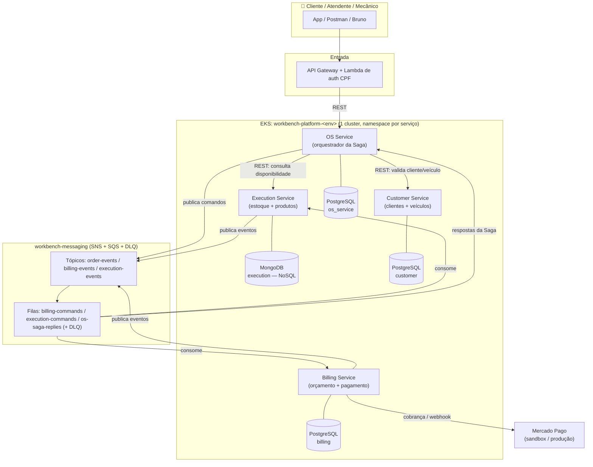
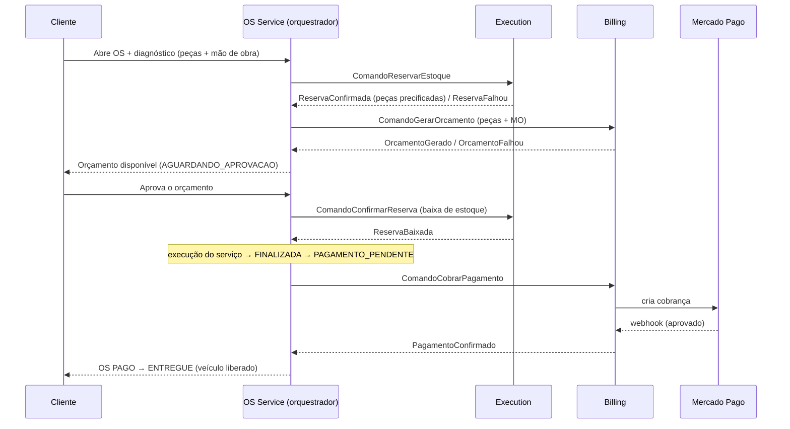
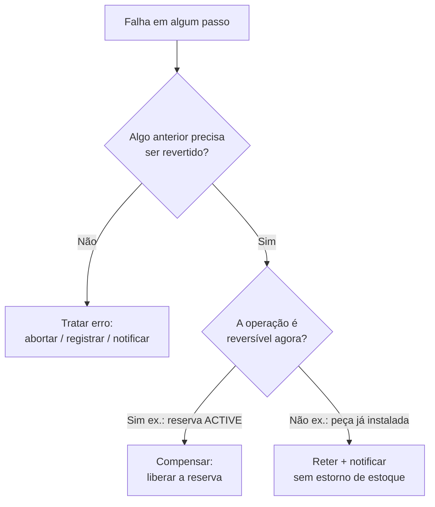

# Workbench — Arquitetura de Microsserviços e Saga (Fase 4)

> Documento-fonte para o **PDF de entrega** do Tech Challenge (FIAP Pós Tech, Fase 4).
> Reúne o diagrama geral da arquitetura, a explicação de cada serviço e da
> comunicação, e uma explicação didática do **Saga Pattern** — o quê, por quê, como
> funciona e para que serve.

---

## 1. Contexto: do monólito aos microsserviços

Na Fase 3, a oficina mecânica era um **monólito** (`workbench-monolith`): uma única
aplicação Spring Boot, um único banco, um único deploy. Isso funcionou enquanto a
operação era pequena.

Com o crescimento (múltiplas filiais, mais ordens de serviço, mais interações entre
atendimento/diagnóstico/execução/cobrança), o monólito passou a ter limites:

- **Acoplamento**: uma mudança em qualquer área exigia reempacotar e reimplantar tudo.
- **Escala única**: não dava para escalar só a parte que sofria carga (ex.: execução/estoque).
- **Resiliência**: uma falha podia derrubar o sistema inteiro.
- **Evolução lenta**: times diferentes mexendo no mesmo código.

A **Fase 4** refatora o monólito em **microsserviços independentes**, cada um com seu
repositório, sua infraestrutura e seu banco de dados próprios — e introduz o
**Saga Pattern** para manter a consistência das transações que agora atravessam
vários serviços.

---

## 2. Diagrama geral da arquitetura



**Leitura rápida do diagrama:**
- O **OS Service** é o ponto de entrada do fluxo e o **orquestrador** da Saga.
- Cada serviço tem **seu próprio banco** — ninguém acessa o banco do outro.
- A comunicação **síncrona (REST)** é usada quando há necessidade de resposta
  imediata (validar cliente/veículo, consultar disponibilidade de estoque).
- A comunicação **assíncrona (SNS/SQS)** carrega os comandos e eventos da Saga.
- O **Billing** integra com o **Mercado Pago** para o pagamento.

---

## 3. Os microsserviços — o quê, por quê e para quê

A divisão seguiu os **bounded contexts** do domínio (DDD): cada serviço é dono de uma
capacidade de negócio coesa e dos dados dela.

### 3.1 OS Service (`workbench-os-service`)
- **Para que serve:** gerenciar o ciclo de vida da Ordem de Serviço (abertura,
  diagnóstico, status, histórico) e **orquestrar a Saga**.
- **Por que existe separado:** é o coração do processo e o coordenador do fluxo
  distribuído; concentra a máquina de estados da OS e o estado da Saga.
- **Banco:** PostgreSQL (estado relacional, com transições validadas no domínio).

### 3.2 Billing Service (`workbench-billing-service`)
- **Para que serve:** gerar o orçamento (peças + mão de obra) e processar o
  pagamento via **Mercado Pago**, com histórico de pagamento (auditoria).
- **Por que existe separado:** cobrança/pagamento é um contexto sensível e com
  integração externa própria; isolá-lo reduz o risco e o acoplamento.
- **Banco:** PostgreSQL.

### 3.3 Execution Service (`workbench-execution-service`)
- **Para que serve:** dono do **estoque** e dos **produtos** (peças/insumos), com o
  ciclo **reserva → baixa → retorno** e a consulta de disponibilidade.
- **Por que existe separado:** o estoque é o ponto de maior concorrência e regra
  transacional; isolá-lo permite escalar e proteger essa parte.
- **Banco:** **MongoDB (NoSQL)** — cumpre o requisito obrigatório de ao menos um
  banco não relacional. A reserva é atômica via transação multi-documento.

### 3.4 Customer Service (`workbench-customer-service`)
- **Para que serve:** cadastro e consulta de **clientes** (CPF/CNPJ) e **veículos**,
  com as validações de domínio (dígitos verificadores, placa, vínculo dono-veículo).
- **Por que existe separado:** é um cadastro consultado por outros serviços; separá-lo
  evita que todos dependam da mesma tabela e respeita o isolamento de dados.
- **Banco:** PostgreSQL.

### 3.5 Componentes de apoio
- **`workbench-messaging`**: infraestrutura de mensageria (tópicos SNS, filas SQS e
  DLQs) via Terraform — roda em LocalStack (dev) ou AWS (produção).
- **`workbench-lambda`**: autenticação de cliente por CPF (emite/valida JWT);
  resolve o cliente **por REST no Customer Service** (não acessa banco).
- **`workbench-gateway`**: API Gateway (rota pública de auth + proxy protegido).
- **`workbench-k8s-terraform`**: VPC + cluster EKS compartilhado.
- **`workbench-database`**: provisionamento do RDS PostgreSQL.

---

## 4. Por que bancos diferentes (SQL + NoSQL)?

O PDF exige **banco próprio por serviço** e **ao menos um SQL e um NoSQL** no
conjunto. A escolha seguiu a **natureza de cada dado**:

| Serviço | Banco | Por quê |
|---|---|---|
| OS, Billing, Customer | **PostgreSQL** | Dados relacionais com integridade forte (estado da OS, orçamento, cadastro) |
| Execution | **MongoDB** | Documentos flexíveis (produto, estoque, movimentações); cumpre o requisito NoSQL |

**Isolamento (requisito destacado do PDF):** nenhum serviço acessa o banco de outro.
Quando o OS precisa validar um cliente, ele **chama o Customer por REST** — não lê a
tabela de clientes. Isso mantém cada serviço dono exclusivo dos seus dados.

---

## 5. Como os serviços se comunicam

Dois estilos, usados onde cada um faz sentido:

### 5.1 REST síncrono (resposta imediata)
- OS → Customer: `GET /api/clients/document/{cpf}` e `GET /api/vehicles/plate/{placa}`
  para validar na abertura da OS.
- OS → Execution: `POST /api/stocks/availability` para checar disponibilidade ao
  montar o orçamento.
- Lambda → Customer: resolve o cliente por CPF ao emitir o token.

### 5.2 Mensageria assíncrona (SNS → SQS, com DLQ)
Carrega os **comandos** (do orquestrador para os participantes) e os **eventos**
(respostas dos participantes). Cada fila tem uma **Dead-Letter Queue**: se uma
mensagem falhar `maxReceiveCount` vezes (3), vai para a DLQ em vez de ficar em loop.
Os consumidores são **idempotentes** (deduplicam por `messageId`), porque o SQS
entrega *at-least-once*.

---

## 6. O que é o Saga Pattern (explicação didática)

### 6.1 O problema
No monólito, criar uma OS com reserva de estoque e orçamento era **uma transação de
banco**: ou tudo acontecia, ou nada (ACID). Com microsserviços, cada serviço tem
**seu próprio banco** — não existe mais uma transação única que abranja todos. Então,
como garantir consistência quando um processo atravessa OS + Execution + Billing?

Exemplo do problema: a OS reserva estoque (no Execution), mas a geração do orçamento
(no Billing) falha. Sem coordenação, o estoque ficaria **reservado para sempre** — um
dado inconsistente.

### 6.2 A ideia do Saga
O **Saga Pattern** resolve isso quebrando a transação distribuída em uma **sequência
de transações locais**, uma em cada serviço. Cada passo:
- faz **commit local** no seu próprio banco, e
- publica um **evento/resposta** dizendo se deu certo.

Se um passo falha, a Saga executa **ações compensatórias** — operações que
**desfazem** (logicamente) os passos anteriores que já tinham sido efetivados. Não é
um `ROLLBACK` de banco (cada commit local já aconteceu); é uma **ação inversa**
explícita (ex.: "liberar a reserva de estoque").

> Em uma frase: **Saga = transação longa feita de passos locais + compensações para
> desfazer o que já foi efetivado quando algo falha.**

### 6.3 Princípio-chave: nem toda falha compensa
Compensa-se apenas o que **já foi efetivado e precisa ser revertido para manter a
consistência**. Se nada precisa ser desfeito, a falha é só **tratada** (retry,
registrar, notificar) — não é compensação. E antes de compensar, vale **tentar
recuperar** (retry), pois muitas falhas são transitórias.

### 6.4 Orquestração vs. coreografia (e nossa escolha)
Há dois estilos de Saga:
- **Coreografada:** não há coordenador; cada serviço reage a eventos dos outros. Mais
  desacoplada, porém o fluxo fica "espalhado" e difícil de auditar/compensar.
- **Orquestrada:** um **orquestrador central** comanda os passos e decide as
  compensações. Mais fácil de entender, auditar e evoluir.

**Escolhemos a Saga ORQUESTRADA**, com o **OS Service** como orquestrador. Justificativa:
- O fluxo tem **pausas humanas** (aprovação do orçamento, webhook de pagamento) e
  ramificações (recusa, falha) — mais simples de coordenar em um ponto central.
- **Compensação explícita**: o orquestrador sabe exatamente o que desfazer.
- **Rastreabilidade**: um único lugar guarda "onde a Saga está" (o estado é
  persistido na tabela `saga_state`), essencial para o monitoramento e a demonstração.

---

## 7. A Saga do Workbench, passo a passo



### 7.1 Máquina de estados da OS

```
RECEBIDA → EM_DIAGNOSTICO → AGUARDANDO_APROVACAO → APROVADO → EM_EXECUCAO
  → FINALIZADA → PAGAMENTO_PENDENTE → PAGO → ENTREGUE
                        └→ (recusa do cliente) RECUSADA
```

### 7.2 Estados do estoque (Execution)
`ACTIVE` (reservado, preso) → `CONFIRMED` (baixa definitiva, na aprovação) →
`RELEASED` (devolvido ao disponível, na compensação).

---

## 8. Rollback e compensação — o que de fato se reverte

Mapa de cada ponto de falha e a ação correta (decisão registrada no ADR-0005):



| Falha | Já foi efetivado | Reverter? | Ação |
|---|---|---|---|
| Reserva de estoque falha | nada | não | **tratar erro** (aborta a Saga) |
| Orçamento falha (após reserva) | estoque `ACTIVE` | sim | **retry**; esgotado → **compensa** (libera reserva) |
| Cliente recusa o orçamento | estoque `ACTIVE` | sim | **compensa** (libera reserva) → OS `RECUSADA` |
| Pagamento falha (após execução) | estoque baixado + peça no veículo | não | **retém** em `PAGAMENTO_PENDENTE` + notifica (não estorna estoque) |

**Por que a falha de pagamento não compensa o estoque?** Porque o serviço já foi
executado e a peça já está instalada no veículo. "Devolver" a peça ao estoque criaria
uma inconsistência física (o sistema diria "peça disponível" com ela já no carro).
Logo, a ação correta é **reter** a OS e cobrar o cliente — tratamento de erro, não
compensação.

**Robustez (comando/resposta perdido):** o `saga_state` guarda o comando pendente, o
número de tentativas e o instante do envio. Um job agendado (`@Scheduled` + **ShedLock**,
uma réplica por janela) **reenvia** comandos vencidos por timeout e, esgotadas as
tentativas, aciona a compensação quando a etapa é reversível.

---

## 9. Qualidade, testes e CI/CD

- **Testes unitários** em todos os serviços + **teste de integração** com Testcontainers
  (PostgreSQL / MongoDB reais).
- **BDD (Cucumber)** no OS Service cobrindo o fluxo completo da OS (requisito do PDF).
- **Cobertura ≥ 80%** por serviço (gate JaCoCo no `verify`): os ~88%, billing ~88%,
  execution ~89%, customer ~87%.
- **CI/CD por serviço** (GitHub Actions): `testes → qualidade (JaCoCo + SonarCloud) →
  build → imagem Docker → deploy Kubernetes`. Imagens publicadas no Docker Hub.
- **Branch `main` protegida** (PR obrigatório + checagens).

---

## 10. Observabilidade

Herdada da Fase 3 e mantida nos serviços: **métricas** (Micrometer → Datadog),
**health checks** (`/actuator/health`, usados pelas probes do Kubernetes) e **logs
estruturados** (JSON) para rastrear um fluxo entre os serviços.

---

## 11. Tecnologias (resumo)

| Camada | Tecnologia |
|---|---|
| Linguagem / framework | Java 21, Spring Boot 4 |
| Bancos | PostgreSQL (OS/Billing/Customer), MongoDB (Execution) |
| Mensageria | AWS SNS + SQS (+ DLQ) |
| Pagamento | Mercado Pago (via porta, com adapter fake para dev) |
| Migrations | Flyway (serviços SQL) |
| Testes | JUnit 5, Testcontainers, Cucumber (BDD) |
| Qualidade | JaCoCo (gate 80%), SonarCloud |
| Build/Deploy | Maven, Docker, Kubernetes (EKS), GitHub Actions |
| Observabilidade | Micrometer, Datadog |

---

## 12. Referências (ADRs)

- **ADR-0003** — divisão em microsserviços + escolha da Saga orquestrada.
- **ADR-0005** — fluxo da OS, estoque (reserva/baixa/retorno), pagamento e compensação.
- Localização: `workbench-monolith/docs/adr/`.
