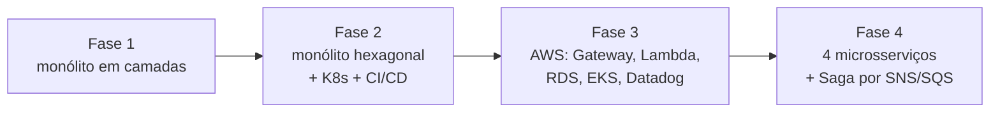

# Evolução das Fases

> [!abstract] O que é esta nota
> O que cada fase do Tech Challenge pediu, onde isso ficava naquela fase, onde está hoje e
> se ainda vale na arquitetura de microsserviços da Fase 4. Levantado contra o código, as
> pipelines e o GitHub em **14/11/2026**.

**Legenda**

| Símbolo | Significa |
|---|---|
| ✅ | Continua e atende ao requisito |
| 🔄 | Continua, mas mudou de forma ou de lugar |
| ⚠️ | Atende só em parte |
| 📄 | Entregável fora do código (vídeo, PDF) |

---

## 1. A linha do tempo

| Fase | O que o PDF pediu | Como o projeto ficou |
|---|---|---|
| **1** | MVP back-end monolítico, DDD, JWT, validação de CPF/placa, Swagger, Docker, 80% de cobertura | Monólito Spring Boot em camadas + PostgreSQL |
| **2** | Clean Code + Clean Architecture, novas APIs, Kubernetes, HPA, Terraform, CI/CD | O mesmo monólito refatorado para hexagonal, com `k8s/`, Terraform e pipeline |
| **3** | API Gateway, Lambda de autenticação por CPF, banco gerenciado, repositórios separados com CI/CD, Datadog, ADR/RFC | AWS: API Gateway + Lambda + RDS + EKS + Datadog |
| **4** | ≥ 3 microsserviços com banco próprio (SQL e NoSQL), mensageria, Saga com compensação, BDD, Sonar, Mercado Pago | 4 microsserviços, SNS/SQS, Saga orquestrada, 3 PostgreSQL + 1 MongoDB Atlas |

**Hoje são 11 repositórios** na org `TechChalleng-FIAP-SOAT`:
- **4 microsserviços:** `workbench-os-service`, `workbench-billing-service`, `workbench-customer-service`, `workbench-execution-service`.
- **5 de infraestrutura:** `workbench-k8s-terraform`, `workbench-database`, `workbench-messaging`, `workbench-lambda`, `workbench-gateway`.
- **2 de apoio:** `workbench-technical-documentation` (este vault) e `workbench-monolith` (base histórica das Fases 1–3).

---

## 2. Onde cada parte do monólito foi parar

| No monólito (Fases 1–3) | Hoje (Fase 4) |
|---|---|
| Clientes, veículos e usuários da equipe | **customer-service** (PostgreSQL) |
| Ordem de serviço, catálogo de serviços, execução dos serviços e tempo médio | **os-service** (PostgreSQL), que também orquestra a Saga |
| Peças, insumos e estoque | **execution-service** (MongoDB), com catálogo único e reservas |
| Orçamento e pagamento | **billing-service** (PostgreSQL) + Mercado Pago |
| Emissão do JWT | **workbench-lambda** (cliente por CPF e login de staff) |
| Validação do JWT | Os 4 serviços validam, além do authorizer do gateway |
| Roteamento de entrada | **workbench-gateway**: cada prefixo vai ao serviço dono |
| Tópico SNS de e-mail | **workbench-messaging**: tópicos, filas, DLQs e o compose local |
| Terraform do cluster | **workbench-k8s-terraform** (VPC + EKS) |
| Banco único | **workbench-database**: uma instância RDS por serviço |
| ADRs e RFCs | Continuam em `workbench-monolith/docs` |
| Documentação técnica | Este vault |

---

## 3. Fase a fase: o que foi entregue e se continua

### Fase 1 — MVP monolítico

| Entrega | Na Fase 1 | Hoje | Continua? |
|---|---|---|---|
| Monólito em camadas | `workbench-monolith` | Substituído por 4 microsserviços | 🔄 Como referência histórica |
| DDD (Event Storming, linguagem ubíqua) | Miro + [[Event Storming - miro]] | Os bounded contexts viraram os limites dos serviços (ADR-0003) | ✅ |
| CRUD de clientes e veículos | Monólito | customer-service: [[API - Clientes]], [[API - Veiculos]] | 🔄 Mudou de repositório |
| CRUD de serviços | Monólito | os-service: [[API - Servicos]] | 🔄 Mudou de repositório |
| CRUD de peças e insumos | `/api/parts` e `/api/supplies` | execution-service: [[API - Pecas e Suprimentos]], [[API - Estoque]] | 🔄 Catálogo único (`Product` PART/SUPPLY) |
| Abertura de OS e orçamento automático | Uma chamada no monólito | OS no os-service, peças no diagnóstico, orçamento no billing pela Saga | 🔄 Distribuído |
| Acompanhamento da OS pelo cliente | Monólito | `GET /order/document/{cpf}`, só o próprio CPF | ✅ |
| Tempo médio de execução | Monólito | [[API - Monitoramento]] | ✅ |
| JWT nas APIs administrativas | Emitido e validado no monólito | Emitido pela Lambda, validado nos 4 serviços ([[JWT]]) | 🔄 Dividido |
| Validação de CPF/CNPJ e placa | Monólito | Value objects `Cpf`, `Cnpj`, `LicensePlate` no customer-service | ✅ |
| Swagger/Postman | Uma collection | SpringDoc + collection por serviço + uma da plataforma | ✅ Ampliado |
| Dockerfile e docker-compose | Um de cada | Um Dockerfile por serviço; compose da plataforma inteira ([[Docker Compose]]) | ✅ |
| Cobertura ≥ 80% | Gate único | Gate JaCoCo por serviço | ✅ |
| Relatório de vulnerabilidades | Scan do monólito | Refeito: [[Relatorio de Vulnerabilidades - Fase 4]] | ✅ |

### Fase 2 — Clean Architecture, Kubernetes e CI/CD

| Entrega | Na Fase 2 | Hoje | Continua? |
|---|---|---|---|
| Clean Code + Hexagonal | Refatoração do monólito | Mesmo padrão em cada serviço, uma classe por caso de uso ([[Padroes de Projeto]]) | ✅ |
| Aprovação/recusa do orçamento por endpoint | Monólito | `POST /order/{id}/decision`, que aciona a Saga | ✅ |
| Listagem ordenada de OS | Monólito | `findActiveOrdersSorted` no os-service | ✅ |
| E-mail de mudança de status | SNS no monólito | Tópico dedicado no `workbench-messaging` | 🔄 Tópico próprio |
| Manifestos K8s | Um conjunto | Um por serviço, cada um no seu namespace | ✅ |
| HPA | Um HPA | Um por serviço, por CPU (ADR-0002) | ✅ |
| Terraform | No repositório da aplicação | Repositórios próprios de infraestrutura | 🔄 Separado |
| Pipeline CI/CD | Uma pipeline | Uma por serviço: testes, Sonar, imagem, deploy no EKS | ✅ |
| Segredos fora do código | Secret do K8s | A pipeline monta o Secret a partir dos secrets da org e falha se faltar algum | ✅ |

### Fase 3 — Nuvem, gateway, serverless e observabilidade

| Entrega | Na Fase 3 | Hoje | Continua? |
|---|---|---|---|
| API Gateway | Tudo ia para o monólito | Rotas por prefixo para o serviço dono | 🔄 |
| Lambda de autenticação por CPF | Lia o banco direto | Consulta o customer-service por REST; também faz login de staff ([[API - Autenticacao]]) | 🔄 |
| Banco gerenciado | 1 RDS | 3 RDS (um por serviço) + MongoDB Atlas | 🔄 |
| Diagrama ER e justificativa do banco | Do monólito | Um ER por instância; justificativa por serviço | ✅ |
| Repositórios separados com CI/CD | 4 | 11 | 🔄 Ampliado |
| `main` protegida com PR | 4 repositórios | Os 11; check `unit-test` exigido nos 4 serviços | ✅ |
| Datadog | Monólito | Agent + APM + dashboards e monitores por serviço; `saga_id` nos logs | ✅ Ampliado |
| RFCs e ADRs | `workbench-monolith/docs` | Mesmo lugar, com ADR-0005 e ADR-0006 novas | ✅ |
| Diagramas de componentes e sequência | Monólito | [[Arquitetura e Saga - Visao Completa V2]], [[Arquitetura Alvo Microsservicos]] | ✅ |

### Fase 4 — Microsserviços e Saga

| Entrega | Hoje | Situação |
|---|---|---|
| ≥ 3 microsserviços com repositório e banco próprios | 4 serviços, 3 PostgreSQL + 1 MongoDB | ✅ |
| Nenhum serviço acessa o banco de outro | REST (customer) + mensageria (Saga) | ✅ |
| Mensageria assíncrona | SNS/SQS, com DLQ em cada fila | ✅ |
| Saga com compensação | Orquestrada no os-service ([[Arquitetura e Saga - Visao Completa V2]]) | ✅ |
| BDD | Cucumber no os-service | ✅ |
| Qualidade no CI | SonarCloud nas 4 pipelines | ✅ |
| Mercado Pago | Checkout Pro + consulta periódica | ⚠️ Chamadas sem timeout (ver seção 5) |
| Contrato das mensagens (extra) | JSON + testes nos 3 serviços da Saga ([[Contratos de Mensagem]]) | ✅ |

---

## 4. Requisitos por tema

### Funcionalidades de negócio

| Requisito | Fase | Hoje | Onde está | O que mudou |
|---|---|---|---|---|
| Abrir OS com cliente, veículo, serviços e peças | 1, 2 | 🔄 | os-service `POST /order` + `POST /order/{id}/diagnosis` | A OS nasce com cliente, veículo e serviços; as peças entram no diagnóstico, que inicia a Saga. Cliente e veículo são validados no customer-service. |
| Status da OS e mudança automática | 1, 2 | 🔄 | `OrderServiceStatusEnum` + `SagaOrchestrator` ([[Ciclo de Vida da OS]]) | Ganhou `APROVADO`, `PAGAMENTO_PENDENTE`, `PAGO` e `RECUSADA`. A Saga muda os status sozinha. |
| Cliente consulta o andamento | 1 | ✅ | `GET /order/document/{cpf}` | Cliente só vê o próprio CPF (403 para outro). |
| Orçamento automático e envio ao cliente | 1, 4 | 🔄 | billing-service ([[Orcamento]]) + e-mail via SNS | Peças precificadas pelo execution + mão de obra por serviço, recebidas por mensagem. |
| Aprovação/recusa por endpoint externo | 2 | ✅ | `POST /order/{id}/decision` | Aprovação dá baixa no estoque; recusa libera a reserva. |
| Listagem ordenada sem Finalizada/Entregue | 2 | ✅ | `findActiveOrdersSorted` | Mesma regra do monólito. |
| E-mail de mudança de status | 2 | 🔄 | Tópico `workbench-os-notifications` | O e-mail do cliente vem do customer-service; o link de pagamento sai pelo mesmo tópico. |
| CRUD de clientes e veículos | 1 | 🔄 | customer-service | Cliente só lê o próprio cadastro; veículo sempre ligado a um cliente. |
| CRUD de serviços e execução | 1 | 🔄 | os-service `/service-types` + `/order/{id}/services` | Cada serviço da OS vai de `TO_DO` a `DONE`; o último `DONE` finaliza a OS. |
| CRUD de peças e insumos com estoque | 1 | 🔄 | execution-service `/api/products` + `/api/stocks` ([[Reserva de Estoque]]) | Catálogo único; reserva, baixa, liberação e estoque mínimo. |
| Tempo médio de execução | 1 | ✅ | os-service `/monitoring` | Entre o primeiro `DOING` e o primeiro `DONE`. |
| Pagamento pelo Mercado Pago | 4 | ✅ | billing-service | Checkout Pro; a confirmação vem de um job que consulta o Mercado Pago. Inclui nova cobrança após recusa e estorno. |

### Arquitetura e dados

| Requisito | Fase | Hoje | Onde está | O que mudou |
|---|---|---|---|---|
| DDD | 1 | ✅ | [[Dominio DDD]], [[Event Storming - miro]] | Os bounded contexts viraram os serviços. |
| Clean/Hexagonal | 2 | ✅ | `domain` → `application` → `adapter`/`infrastructure` em cada serviço | Uma classe por caso de uso; agregados sem setters; código em inglês, mensagens ao cliente em português. |
| Microsserviços com banco próprio | 4 | ✅ | 4 serviços, um namespace cada no EKS | — |
| Saga com compensação | 4 | ✅ | `SagaOrchestrator` + ADR-0005 | Orquestrada. Compensa liberando o estoque na recusa ou falha do orçamento. Reenvio por timeout com ShedLock; eventos repetidos, fora de ordem ou de uma rodada anterior são descartados; comandos saem só depois do commit; trava otimista impede duas decisões simultâneas na mesma OS. |
| Banco gerenciado por Terraform | 3 | 🔄 | `workbench-database` + MongoDB Atlas | De uma instância RDS para três. O Atlas é criado no painel. |
| SQL e NoSQL | 4 | ✅ | PostgreSQL ×3 + MongoDB | Transações multidocumento no Mongo (`MongoTransactionManager`). |
| Modelagem com ER | 3 | ✅ | README do `workbench-database` | Um ER por instância; schemas versionados por Flyway. |

### Segurança

| Requisito | Fase | Hoje | Onde está | O que mudou |
|---|---|---|---|---|
| JWT nas APIs | 1 | 🔄 | [[JWT]], [[Spring Security Config]] | Os 4 serviços validam o token; a emissão saiu para a Lambda. |
| Autorização por papel e por dono | 3, 4 | ✅ | [[Autorizacao e Roles]] | Cliente só vê e decide os próprios dados. |
| API Gateway | 3 | 🔄 | `workbench-gateway` | Cada prefixo vai ao serviço dono, com authorizer JWT. |
| Function serverless de autenticação | 3 | 🔄 | `workbench-lambda` | Consulta o customer-service por REST, não o banco. |
| Login de staff | 3 | ✅ | customer-service | Senha inicial do admin por secret; bloqueio após 5 erros seguidos. |
| Segredos fora do código | 2 | ✅ | Secrets da org → pipeline | Os `k8s/secret.yaml` só têm placeholders. |
| Scan de vulnerabilidades | 1 | ✅ | [[Relatorio de Vulnerabilidades - Fase 4]], [[OWASP ZAP]] | ZAP e Trivy sem achados HIGH/CRITICAL nem FAIL/WARN; SAST no Sonar. |

### Qualidade e testes

| Requisito | Fase | Hoje | Onde está | O que mudou |
|---|---|---|---|---|
| Testes unitários e de integração | 1, 2, 4 | ✅ | `src/test` de cada serviço ([[Rodando Testes]]) | 450 testes, 0 falhas (15/11/2026): os 231, billing 69, customer 79, execution 71. |
| Cobertura ≥ 80% | 1, 4 | ✅ | Gate JaCoCo no `verify` | Linhas em 15/11/2026: os 90,4%, execution 89,1%, customer 86,9%, billing 85,6%. |
| BDD | 4 | ✅ | `ordem_servico.feature` (os-service) | Fluxo feliz, recusa e transição inválida. |
| Sonar no CI | 4 | ✅ | Job `code-analysis` ([[SonarQube]]) | Entrou na Fase 4. |
| Testes de contrato | 4 (extra) | ✅ | `*SagaContractTest` nos 3 serviços da Saga | O CI compara a cópia de cada serviço com o contrato do `workbench-messaging`. |

### Infraestrutura, CI/CD e observabilidade

| Requisito | Fase | Hoje | Onde está | O que mudou |
|---|---|---|---|---|
| docker-compose completo | 1, 2 | ✅ | `workbench-messaging/docker-compose.dev.yml` ([[Quickstart]]) | Com `--profile app`, sobe LocalStack, os bancos, os 4 serviços e um gateway local em `:8000`. |
| Manifestos e HPA | 2 | ✅ | `k8s/` de cada serviço | Um namespace por serviço; HPA por CPU. |
| Terraform do cluster | 2, 3 | 🔄 | `workbench-k8s-terraform` | Repositório próprio desde a Fase 3. |
| Pipeline por serviço | 2, 4 | ✅ | `.github/workflows/pipeline.yml` | `unit-test → code-analysis → build → docker-build-push → deploy-aws` (+ `datadog-config`). |
| Homologação e produção | 3 | ✅ | `develop` e `main` | O nome da branch é o ambiente; deploy no EKS com `USE_AWS=true`. |
| Datadog: latência, CPU/memória, uptime, alertas | 3 | ✅ | Dashboards e monitores versionados em cada serviço | Um dashboard por serviço + um da plataforma. |
| Logs JSON com correlação | 3 | ✅ | Logstash encoder + `dd.trace_id` + `saga_id` | Uma busca por `@saga_id` mostra a OS em todos os serviços. |

### Documentação

| Requisito | Fase | Hoje | Onde está |
|---|---|---|---|
| README por repositório | 1, 2, 3 | ✅ | Cada repositório |
| Swagger/Postman | 1–4 | ✅ | SpringDoc em cada serviço + `postman/` |
| Diagramas de componentes e sequência | 3, 4 | ✅ | [[Arquitetura e Saga - Visao Completa V2]], [[Arquitetura e Saga - Visao Completa]] |
| RFCs e ADRs | 3, 4 | ✅ | `workbench-monolith/docs/rfc` (RFC-0001 a 0003) e `docs/adr` (ADR-0001 a 0006) |
| Contratos de mensagem | 4 | ✅ | [[Contratos de Mensagem]] |
| Documentação de API por domínio | 1 | 🔄 | Pasta `03 - API`, reescrita para os microsserviços |

---

## 5. Limitações conhecidas

> [!warning] Registradas em 14/11/2026
> - **Chamadas HTTP sem timeout:** billing → Mercado Pago e os-service → customer-service. Se o Mercado Pago aceitar a conexão e não responder, nenhum pagamento é confirmado até o pod reiniciar.
> - **Conferência do contrato no CI:** só funciona com `contracts/saga-messages.json` na `main` do `workbench-messaging`; sem ele, o passo avisa e segue.
> - **Limite de login por réplica:** com N pods, são N × 5 tentativas por janela (decisão registrada no código).
> - **Estorno sem gatilho:** o billing sabe estornar, mas nenhuma regra da Saga pede estorno hoje.
> - **Reserva sem prazo:** uma OS que nunca é aprovada nem recusada mantém as peças reservadas.
> - **Estoque baixo lido por inteiro:** `findLowStock` filtra em memória, porque os valores estão gravados como texto no MongoDB.

---

## 6. Entregáveis fora do código

| Entregável | Fase | Hoje | Observação |
|---|---|---|---|
| Vídeo de até 15 min | 1–4 | 📄 | Roteiro da Fase 4 pronto; o da Fase 3 está em `workbench-monolith/docs/roteiro-video.md`. |
| PDF de entrega (grupo, links, diagrama, Saga) | 1–4 | 📄 | Não versionado. |
| Usuário `soat-architecture` com acesso | 1–4 | ✅ | Colaborador dos 11 repositórios (conferido em 14/11/2026). |
| Evidência de cobertura | 4 | ✅ | READMEs dos serviços, artefato `jacoco-report` de cada execução e Quality Gate do Sonar. |

---

## Notas relacionadas

- [[Visao Geral]] — os 4 microsserviços e a Saga em uma página
- [[Arquitetura e Saga - Visao Completa V2]] — fluxo completo da Saga
- [[Convencoes Microsservicos]] — padrões seguidos em todos os serviços
- [[Relatorio de Vulnerabilidades - Fase 4]] — scans e correções
