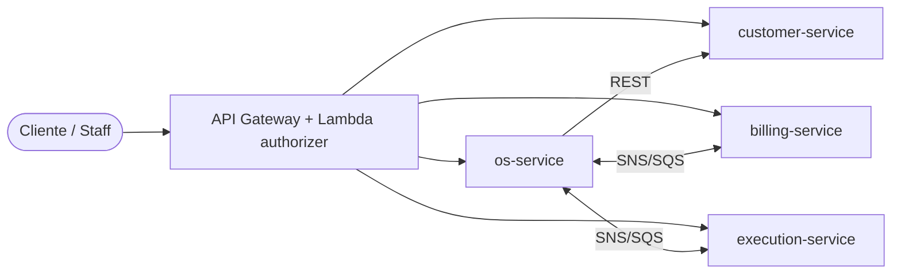

# Visão Geral

Sistema de gestão de oficina mecânica (**Workbench**): abertura de OS, diagnóstico, orçamento,
aprovação pelo cliente, execução, pagamento e entrega, com controle de estoque de peças e
insumos e monitoramento do tempo de execução.

## Evolução

| Fase | Arquitetura |
|---|---|
| 1–2 | Monólito Spring Boot (DDD + hexagonal), PostgreSQL, Kubernetes |
| 3 | AWS: API Gateway + Lambda de auth, RDS, EKS, Datadog, repositórios separados |
| **4 (atual)** | **4 microsserviços** + Saga orquestrada por SNS/SQS |

Requisito por requisito, com o que mudou de lugar entre as fases: [[Evolucao das Fases]].
Por que cada escolha (bancos, Saga, mensageria, nuvem): [[Decisoes de Arquitetura]].

## Microsserviços

| Serviço | Bounded context | Banco | Papel na Saga |
|---|---|---|---|
| **os-service** | Ordem de serviço, catálogo de serviços, monitoramento | PostgreSQL | **Orquestrador** |
| **customer-service** | Clientes, veículos, usuários staff | PostgreSQL | — (consultado por REST) |
| **billing-service** | Orçamento e pagamento (Mercado Pago) | PostgreSQL | Participante |
| **execution-service** | Peças/insumos, estoque e reservas | MongoDB | Participante |

- Cada serviço tem **repositório, pipeline e banco próprios**; nenhum lê o banco de outro (ADR-0006).
- Login pela `workbench-lambda` (cliente por CPF, staff por e-mail/senha); JWT RS256 validado
  no gateway e em cada serviço.
- Observabilidade: logs JSON com `saga_id`, métricas e dashboards no Datadog.

Detalhes: [[Arquitetura e Saga - Visao Completa V2]], [[Arquitetura Alvo Microsservicos]].

## Links Relacionados
- [[Tecnologias]]
- [[Estrutura de Pastas]]
- [[Padroes de Projeto]]
