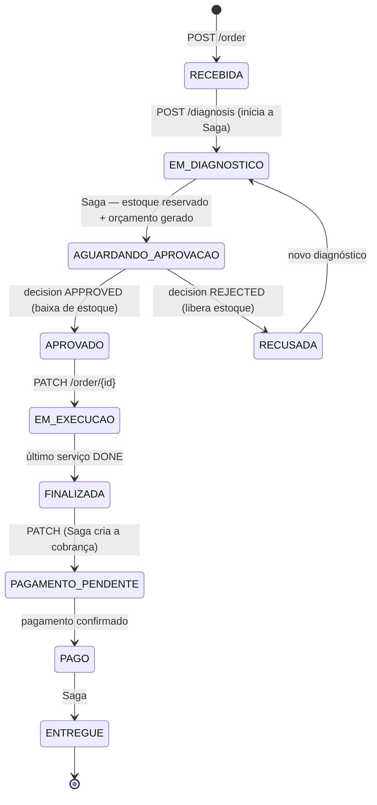

# Ciclo de Vida da OS

## Regras

- Só a próxima transição do diagrama é aceita; qualquer outra → **422**.
- `AGUARDANDO_APROVACAO`, `APROVADO`, `RECUSADA`, `PAGO` e `ENTREGUE` são decididos pela
  **Saga**: numa OS com Saga, pedi-los no `PATCH /order/{id}` → **409**.
- **Serviços da OS:** cada um anda `TO_DO → DOING → DONE` (`PATCH /order/{id}/services/{sid}/status`),
  só com a OS em `EM_EXECUCAO`. O último `DONE` leva a OS para `FINALIZADA`; `FINALIZADA`
  manual com serviço pendente → **409**.
- **Falta de estoque no diagnóstico:** a Saga vai para `FALHOU` e a OS fica em
  `EM_DIAGNOSTICO`; o motivo está em `GET /order/{id}/saga` e um novo diagnóstico recomeça a Saga.
- **Pagamento recusado:** a OS segue em `PAGAMENTO_PENDENTE`; `POST /order/{id}/payment-retry`
  gera nova cobrança.
- Cada mudança de status notifica o cliente por e-mail (tópico SNS de notificações) e registra
  o tempo no status (métrica no Datadog).

Rotas: [[API - Ordens de Servico]] · [[API - Servicos]] · Saga: [[Arquitetura e Saga - Visao Completa V2]].

## Links Relacionados
- [[Reserva de Estoque]]
- [[Orcamento]]
