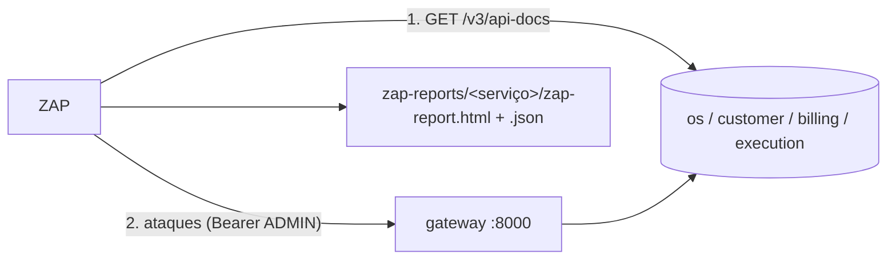

# OWASP ZAP — Scan de Segurança (DAST)

O **OWASP ZAP** testa a API **em execução**, mandando payloads de ataque (injeção, XSS,
path traversal, Spring4Shell…) para cada rota. É o complemento do **SAST** (SonarCloud, que
lê o código) e do **SCA** (Trivy, que olha as dependências) — ver
[[Relatorio de Vulnerabilidades - Fase 4]].

> [!info] Fase 1 × Fase 4
> Na Fase 1 o ZAP rodava contra o monólito (`workbench-monolith/zap`). Na Fase 4 ele roda
> contra **os 4 microsserviços, atacando pelo gateway** — o mesmo caminho de um cliente real.

## Como está montado

Tudo em `workbench-messaging`:

| Arquivo | Papel |
|---|---|
| `docker-compose.dev.yml` → serviço `zap` (profile `scan`) | Imagem `zaproxy/zap-stable:2.16.1`, depende do gateway e dos serviços |
| `zap/scan-platform.sh` | Roda um container ZAP por serviço e mostra o resumo |
| `zap/zap-scan.sh` | Para cada serviço: lê a spec OpenAPI direto do container e ataca pelo gateway |
| `zap/rules.conf` | O que é `FAIL` (bloqueia), `WARN` ou `IGNORE` — cada linha com justificativa |
| `local-gateway/nginx.conf` | Gateway local com o mesmo roteamento por prefixo do API Gateway da AWS |



- **Token:** o `scan-platform.sh` assina um JWT de ADMIN (RS256, 1 h) com a chave de dev de `dev-keys/` — local
  não existe a Lambda de login, e assim nenhum token fica fixo no repositório. O ZAP injeta
  o `Authorization` em toda requisição (replacer).
- **Alvo:** `-t http://<serviço>:8080/v3/api-docs` (a spec) e `-O http://gateway:8000`
  (troca o host da spec pelo gateway).
- **Resultado:** `0` limpo · `1` algum `FAIL` do `rules.conf` · `2` só `WARN` · `3` erro do ZAP.
  O script só falha (exit 1) com `FAIL` ou erro; `WARN` vai para o relatório.

## Rodar

```bash
cd workbench-messaging
docker compose -f docker-compose.dev.yml --profile app up -d --build          # plataforma
zap/scan-platform.sh                     # os 4 serviços, um container ZAP por serviço
open zap-reports/os-service/zap-report.html
```
Um serviço só: `zap/scan-platform.sh billing-service`. Os relatórios (`zap-reports/`) não
são versionados.

## `rules.conf`

| Nível | Regras |
|---|---|
| `FAIL` | XSS refletido/persistente, SQL Injection, Path Traversal, OS Command Injection, Server Side Code Injection, XXE, Log4Shell, Spring4Shell, SSRF, RCE Spring |
| `WARN` | CORS (10098) |
| `IGNORE` | CSRF (API stateless com Bearer), timestamp e Base64 em resposta, aviso de versão do próprio ZAP |

## Problemas conhecidos

- Vários `zap-api-scan.py` no mesmo container falham de forma intermitente ao subir o segundo
  daemon (o primeiro deixa `~/.ZAP/.homelock`). Por isso o `scan-platform.sh` usa um container
  novo por serviço (e o `zap-scan.sh` ainda apaga o lock por garantia).
- Parâmetros de caminho (`{id}`) entram vazios ou com valor de exemplo — a maior parte dessas
  chamadas volta 400/404 (alerta informativo 100000), o que é o comportamento esperado.

## Links Relacionados
- [[Relatorio de Vulnerabilidades - Fase 4]]
- [[Spring Security Config]]
- [[JWT]]
- [[SonarQube]]
