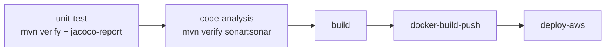

# SonarCloud — Qualidade e Cobertura

Cada microsserviço é um projeto no **SonarCloud** (organização `techchalleng-fiap-soat`,
chave `TechChalleng-FIAP-SOAT_<repositório>`). Configuração no `pom.xml`:

```xml
<sonar.organization>techchalleng-fiap-soat</sonar.organization>
<sonar.projectKey>TechChalleng-FIAP-SOAT_workbench-os-service</sonar.projectKey>
<sonar.host.url>https://sonarcloud.io</sonar.host.url>
<sonar.coverage.jacoco.xmlReportPaths>target/site/jacoco/jacoco.xml</sonar.coverage.jacoco.xmlReportPaths>
```

## No pipeline



- `unit-test`: confere a cópia do contrato da Saga, roda `mvn verify` (unit, integração,
  contrato, BDD) e publica o JaCoCo como artefato `jacoco-report`. É o **check obrigatório**
  da branch protection da `main`.
- `code-analysis`: `mvn verify sonar:sonar` com o secret `SONAR_TOKEN` (sem o secret, roda só o
  gate de cobertura e avisa). O Quality Gate do Sonar aparece no PR.

## Gates

| Gate | Onde | Regra |
|---|---|---|
| Cobertura de linhas | JaCoCo `check` no `verify` | **≥ 80%** — abaixo disso o build falha |
| Quality Gate | SonarCloud | gate padrão "Sonar way" (bugs, vulnerabilidades, code smells, duplicação e cobertura no código novo) |

Cobertura atual: os 89,8% · execution 88,7% · customer 86,6% · billing 85,6% — ver
[[Rodando Testes]].

## Complementos de segurança

O Sonar é o **SAST**. DAST (OWASP ZAP) e SCA (Trivy) estão em
[[Relatorio de Vulnerabilidades - Fase 4]].

## Rodar a análise local

```bash
./mvnw verify sonar:sonar -Dsonar.token=<seu token do SonarCloud>
```

## Links Relacionados
- [[Rodando Testes]]
- [[OWASP ZAP]]
- [[Relatorio de Vulnerabilidades - Fase 4]]
